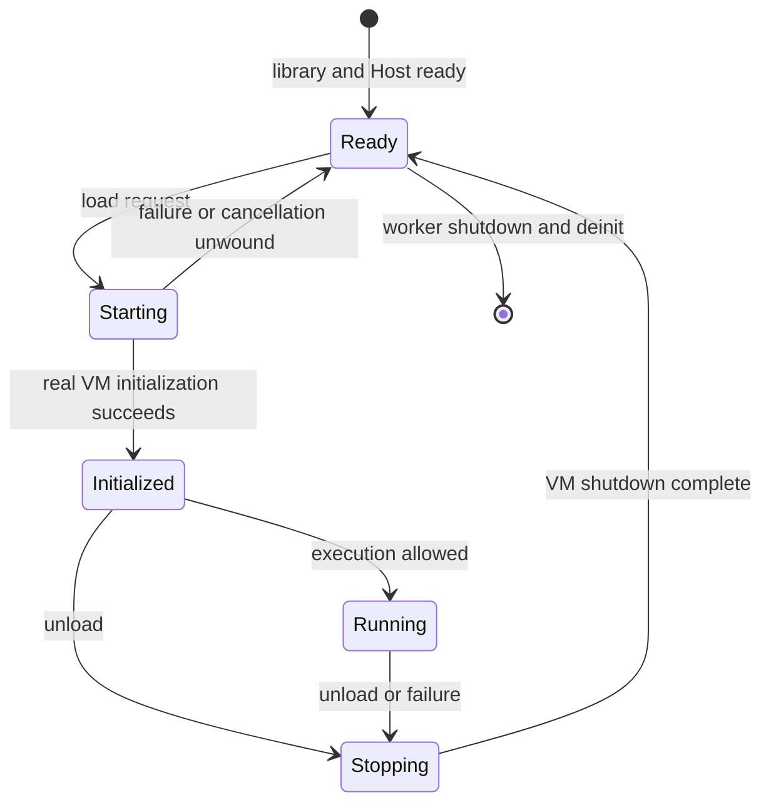

# M1 — Minimal libretro Host

M1 is complete for Windows x86-64. The core provides a real VM lifecycle, recoverable startup failures, content reuse, and repeatable initialization and teardown through the libretro Host. It uses a core-owned Vulkan device, placeholder video, and Null audio. This document describes the integration architecture and lifecycle acceptance contract. Reference revisions are fixed in the [baseline definition](baseline.md).

## Goal and limits

Build a Windows x86-64 shared library that a libretro frontend can load, connect x6's real Host and VMManager interfaces, forward useful logs, and shut down safely. At least one genuine VM initialization/shutdown cycle is required. ABI exports with simulated VM state changes are only an intermediate step.

M1 does not require a visible game checkpoint, usable game audio, JVS input, or performance improvements. Minimum graphics and device initialization needed by a real VM belongs here. System246 boot parity belongs to M2 and complete basic audio/video/input belongs to M3.

## What PCEE2 actually provides

The following references use PCEE2 revision `5719627731beb90e379ff1be1223391b7f563b3b`. Its recorded PCSX2 base is newer than the x6 baseline, so these are integration references rather than a patch to apply wholesale.

| Reference | Observed responsibility | Proposed use |
| --- | --- | --- |
| [`pcee2-libretro/CMakeLists.txt`](https://github.com/WizzardSK/pcee2-libretro/blob/5719627731beb90e379ff1be1223391b7f563b3b/pcee2-libretro/CMakeLists.txt) | Shared library linked with `PCSX2` and `PCSX2_FLAGS`, frontend sources, platform link options | Reuse the target shape with project-specific naming; review DLL dependencies and exports |
| [`pcee2-libretro/Libretro.cpp`](https://github.com/WizzardSK/pcee2-libretro/blob/5719627731beb90e379ff1be1223391b7f563b3b/pcee2-libretro/Libretro.cpp) | ABI, settings, CPU worker, session requests, logs, frame handoff, Host implementations | Adapt the minimum lifecycle path; keep later features out of the first import |
| [`pcsx2/GS/GS.h`](https://github.com/WizzardSK/pcee2-libretro/blob/5719627731beb90e379ff1be1223391b7f563b3b/pcsx2/GS/GS.h), [`GSRenderer.cpp`](https://github.com/WizzardSK/pcee2-libretro/blob/5719627731beb90e379ff1be1223391b7f563b3b/pcsx2/GS/Renderers/Common/GSRenderer.cpp) | Framebuffer readback and duplicate-frame callbacks | Later readback reference; these hooks are absent from the x6 baseline |
| [`GSLibretro.h`](https://github.com/WizzardSK/pcee2-libretro/blob/5719627731beb90e379ff1be1223391b7f563b3b/pcsx2/GS/Renderers/Common/GSLibretro.h), Vulkan/OpenGL bridges in the same renderer tree | Frontend-owned presentation and hardware-context sharing | Defer zero-copy and shared-context bridges unless the selected first path requires them |
| [`pcsx2/SPU2/spu2.h`](https://github.com/WizzardSK/pcee2-libretro/blob/5719627731beb90e379ff1be1223391b7f563b3b/pcsx2/SPU2/spu2.h) | `CustomOutputStreamFactory` routes sound to a frontend-owned stream | Defer to M3; x6 already has a Null audio backend for lifecycle checks |
| [`LibretroVFS.cpp`](https://github.com/WizzardSK/pcee2-libretro/blob/5719627731beb90e379ff1be1223391b7f563b3b/pcee2-libretro/LibretroVFS.cpp) and `common/FileSystemVFS.h` | Routes native file access through frontend VFS hooks | Defer full VFS adaptation; M1 uses native desktop file paths |
| [`cmake/EmbedResources.cmake`](https://github.com/WizzardSK/pcee2-libretro/blob/5719627731beb90e379ff1be1223391b7f563b3b/cmake/EmbedResources.cmake) and resource readers | Embeds selected shaders, fonts, and GameDB | Start with matching external x6 resources; embedding is a separate packaging choice |
| [`common/Windows/WinHostSys.cpp`](https://github.com/WizzardSK/pcee2-libretro/blob/5719627731beb90e379ff1be1223391b7f563b3b/common/Windows/WinHostSys.cpp) | Page-fault-handler installation and removal for an unloadable module | Prefer pairing handler ownership with x6 fastmem allocation/free rather than copying the frontend-level workaround |
| [`VKShaderCache.cpp`](https://github.com/WizzardSK/pcee2-libretro/blob/5719627731beb90e379ff1be1223391b7f563b3b/pcsx2/GS/Renderers/Vulkan/VKShaderCache.cpp) | Static shaderc option in addition to dynamic loading | Reference for resolving the Vulkan compiler dependency and its teardown |

PCEE2's frontend depends on supporting emulator hooks; adapt the relevant interfaces together with the frontend code.

## x6 boundary to preserve

Read the fixed x6 [`Host.h`](https://github.com/PS2Homebrew-arcade/pcsx2x6/blob/583f0e90907d69bb2db670f570d0865260fcc71b/pcsx2/Host.h), [`VMManager.h`](https://github.com/PS2Homebrew-arcade/pcsx2x6/blob/583f0e90907d69bb2db670f570d0865260fcc71b/pcsx2/VMManager.h), [`VMManager.cpp`](https://github.com/PS2Homebrew-arcade/pcsx2x6/blob/583f0e90907d69bb2db670f570d0865260fcc71b/pcsx2/VMManager.cpp), and [`pcsx2-qt/QtHost.cpp`](https://github.com/PS2Homebrew-arcade/pcsx2x6/blob/583f0e90907d69bb2db670f570d0865260fcc71b/pcsx2-qt/QtHost.cpp) together.

- Set `VMBootParameters::filename` to the manifest path and leave `source_type` unset so VMManager's `AutoDetectSource` handles `.acgame`. The `arcade` field is populated by GameList but is not consumed by VMManager startup; the Host does not need to fill it. Retain the upstream structure without treating this field as the boot contract.
- Use `VMManager::Internal::CPUThreadInitialize()` for worker-level initialization and `CPUThreadShutdown()` for its matching teardown. `CPUThreadInitialize()` releases what it acquired when it fails, so `CPUThreadShutdown()` only follows a successful initialization.
- Use `VMManager::Initialize(params, &error)`, `VMManager::Execute()`, and `VMManager::Shutdown(false)` for each session. Initialization success leaves x6 paused; transition to `Running` only when execution is requested.
- Retain existing partial-initialization guards and extend them for the missing arcade cleanup described below. Do not call the full shutdown path against an initialization that has already unwound itself.
- Build the frontend-owned Host symbol inventory from declarations, definitions, and link results. Declarations also occur in `Achievements.h`, `ImGui/FullscreenUI.h`, `ImGui/ImGuiManager.h`, and `Input/InputManager.h`; the three main headers are not an exhaustive list. Retain the shared Host implementation already provided by the emulator and avoid duplicate definitions or hidden Qt dependencies.

### Arcade startup rollback

`AutoDetectSource` opens ACATA media and changes arcade state before BIOS loading, so BIOS preflight alone cannot protect later initialization failures. `ClearArcadeIdentity()` resets identity, clocks, iLink and System256 state; `CloseArcadeMedia()` releases media. Both normal shutdown and the `Initialize()` failure guard call them. `IO_CloseImage()` clears the handle, the image-size failure path closes the file it opened, and an image still open when a new one is opened is logged and closed instead of being overwritten. These emulation-side changes remain separate from the libretro adapter for upstream review.

## Source and build layout

The emulation sources retain their upstream paths under `pcsx2/` and `common/`, with build support in `cmake/`, resources in `bin/`, and dependencies in `3rdparty/`. The libretro frontend uses the following boundaries:

| File or area | Responsibility |
| --- | --- |
| `libretro/CMakeLists.txt` | `pcsx2x6_libretro` shared-library target and platform export rules |
| `libretro/Libretro.cpp` | `retro_*` ABI, callback storage, frontend-thread work |
| `libretro/LibretroHost.cpp` and `.h` | x6 Host adapter, settings, paths, logging |
| `libretro/LibretroSession.cpp` and `.h` | CPU worker, session commands, completion and stop handling |
| `libretro/libretro.h` and `pcsx2x6_libretro.info` | ABI declarations and accurate frontend metadata |
| Focused changes in `common/`, `pcsx2/`, and `cmake/` | Only hooks, cleanup, and build integration required by the selected path |

The `pcsx2x6_libretro` shared-library target links the existing `PCSX2` target and its required ISA variants. In Multi-ISA configurations `PCSX2` is an object library. The core exports only the libretro ABI and upstream's debugger memory symbols (`EEmem`, `IOPmem`, `VUmem`), uses the static CRT, and has no runtime DLL dependency beyond the operating system. `libretro/deps/` defines core dependency acquisition and versions; [upstream.md](upstream.md) records their provenance.

Source revisions and the current integration differences are recorded in [upstream.md](upstream.md).

## Frontend and Host responsibilities

| Entry point or hook | M1 responsibility |
| --- | --- |
| `retro_set_environment` and callback setters | Store callbacks and obtain logging; handle unsupported optional interfaces |
| `retro_get_system_info`, `retro_get_system_av_info`, `retro_api_version` | Report this core's identity and conservative, valid metadata; advertise only the intended content path |
| `retro_init` | Keep initialization lightweight: callback/logging setup and library-level state, without CPU-thread creation or VM-memory allocation |
| `retro_load_game` | Validate the request and BIOS, resolve settings/resources, copy owned boot parameters, create the CPU worker on first load, and obtain the session startup result |
| `retro_run` | Service pending frontend work, advance the basic run handshake, and return within a defined wait budget; placeholders do not count as game rendering |
| `retro_unload_game` | Cancel pending boot or stop the active VM, wake every core-owned wait, and wait for session cleanup |
| `retro_deinit` | Also handle an active session; finish worker and process-level cleanup before the module is unloaded |
| `Host::RunOnCPUThread` / `RunOnGSThread` | Dispatch to the owning thread; direct execution is permitted when already on that owner |
| `Host::PumpMessagesOnCPUThread` | Drain commands at x6's existing emulated-vsync point and implement a cancelable run gate; service commands in an idle loop while the VM is not executing |
| VM notifications, error/progress/UI hooks | Record lifecycle and errors; provide deliberate headless behavior without Qt dialogs or process exit |

All required ABI exports must exist, including functions for unsupported features. Savestates and cheats must report unsupported behavior rather than successful no-ops. Do not inherit PCEE2's broad content extensions, memory exposure, disk-control interface, or no-content support without implementing their contracts. The initial content route can pass a native `.acgame` path unchanged to x6; that is not M2 boot acceptance.

## Settings, resources, and logging

Use a long-lived `MemorySettingsInterface` as the base settings layer, register it once per live Host context, and populate x6 defaults before applying the small set of frontend overrides. Core options are the frontend configuration source; do not silently adopt a user's standalone `PCSX2.ini` or copy PCEE2's optional INI-merging behavior.

Directory contract:

| Frontend location | Core use |
| --- | --- |
| System directory plus `pcsx2x6/bios/` | BIOS images and their NVRAM/MEC companions; companion files retain x6's writable board-state behavior |
| System directory plus `pcsx2x6/resources/` | Matching x6 runtime resources |
| System directory plus `pcsx2x6/memcards/` and `cache/` | Working dongles and shader caches; play-time metadata is stored at the system core root |
| Save root | Per-game SRAM and optional save cards, as defined in [M2](M2.md#writable-state-contract) |

Both frontend directories must be reported and absolute, otherwise content loading fails with a specific error. The system and save roots must be separate; the overlap check compares file-system objects rather than their spelling. A save directory already assigned to PCSX2x6 by the frontend is used directly, including content-specific subdirectories; otherwise the core appends `pcsx2x6`. Frontend paths are normalized to native separators because the Windows file layer rejects absolute paths with forward slashes. The `pcsx2x6_bios` core option defaults to `auto`: content loading selects the first valid COH-H arcade BIOS in filename order from the system BIOS folder. Identification uses ROM contents, not extensions. A manually selected image overrides discovery and must pass preflight. The previous `none` value is accepted as an alias for automatic selection.

BIOS images are used in place. Keep all same-stem companions beside them, including `.nvm`/`.mec` and any extra ROMs: `LoadExtraRom` tries both `name.bin.rom1` and `name.rom1`, likewise for `.rom2`. x6 writes NVRAM and can create a MEC file in that folder. The system core root also contains the working dongles, caches and play-time metadata; it is not a read-only input tree. Keep archival originals separate from the runtime system directory.

Validation uses disposable system and save trees. The Host passes separate SRAM and dongle directories through the boot parameters; manifest parsing stays in x6. `EmuFolders::MemoryCards` points at optional save cards, while an absolute slot-1 filename selects the system dongle. Startup loads folder settings without creating the full set of emulator directories; only active storage needs are created.

Never fall back silently to the frontend executable's current directory when a required directory is absent. Disable standalone controller discovery, hotkeys, achievement/login prompts, rich presence, and desktop pacing unless required by the chosen diagnostic path. Resolve and validate the selected BIOS before submitting startup: x6's `LoadBIOS()` otherwise calls `FindBiosImage()` when the configured file is missing. A missing or invalid manual choice must fail rather than silently use another image. Settings alone do not disable x6's fallback, so preflight and CPU-side configuration must stay consistent.

Use x6's existing `Log::SetHostOutputLevel` callback to map levels into the libretro log interface. `Console.Error` and `Console.Warning` log at the information level and carry severity only in their colour, so the mapping uses both. A bounded queue drained on the frontend thread keeps worker messages away from callbacks with unclear thread requirements. Drain it during startup and teardown wait loops as well as `retro_run()`. Initialization-time error, confirmation, and progress hooks must finish without waiting for frontend-thread work; use explicit headless policy and queued notifications. Keep logging useful when the frontend offers no log interface, avoid format-string forwarding, and disconnect all callbacks before their lifetime ends. Record core/source identity, startup result, and each cleanup stage without publishing user-specific runtime paths in project documentation.

## Worker and session lifecycle

Create the CPU worker on the first `retro_load_game()`, as PCEE2 does, and retain it across content sessions until deinit. `CPUThreadInitialize()` allocates VM memory, so it does not belong in lightweight `retro_init()`. x6's Qt frontend called `CPUThreadShutdown()` after a failed initialization, which released resources that were never acquired, such as COM after a failed `CoInitializeEx`. The project instead makes `CPUThreadInitialize()` unwind its own partial work. After failed initialization the worker exits, so a later load can create a new one. After complete deinit, likewise create the next worker on the next load, not on `retro_init()` alone.

These are Host/session concepts, not replacements for x6's `VMState` enum. A deinit request from any active state first cancels or stops the session, then shuts down the worker.

| Owner | Owns or performs |
| --- | --- |
| Frontend callback thread | Libretro callbacks, request validation, log draining, publishing requests, and monitored waits; no direct VM state transitions |
| CPU worker | VM initialization/execution/shutdown, all requested state transitions, settings application, queued CPU work |
| GS worker | Existing MTGS commands and graphics resources; no direct frontend video callback |
| Session synchronization | Owned boot parameters, startup result, cancellation, completion, run token and frame/progress notification |

Use explicit startup and completion acknowledgements. For the initial path, which needs no frontend hardware-context callback, return `false` from `retro_load_game` only after a known startup failure has fully unwound its session resources. Worker-initialization failure also requires its matching cleanup. If a future hardware path must return before VM initialization to let `context_reset` run, document that asynchronous contract and its failure reporting separately. Never wait in `retro_load_game` for a callback the frontend can only invoke after it returns.

The frontend publishes stop/cancel requests to the command path and wakes session, command, and frame waits even if no more `retro_run` calls arrive. The CPU thread performs `SetState`, including pause and stop: these calls can wait for VU/GS work or interrupt CPU execution and are not just atomic flag writes. Do not copy PCEE2's frontend-thread `SetState(Stopping)` calls as a general synchronization contract.

Start by validating x6's existing control path. Its vsync is driven by emulated-time counters and does not depend on a rendered image; BIOS execution and execution before the first visible frame still reach `PumpMessagesOnCPUThread`. The Qt frontend uses this command-service point too. While the VM is paused or between sessions, provide an idle command-wait loop; when stopping, also wake the run-token gate so the CPU can process the request after the frontend stops calling `retro_run()`.

Do not add a new non-vsync interruption mechanism or atomic execution-interruption request in advance. Validate the existing vsync/idle-loop/run-gate path first, and propose an additional mechanism only if a reproducible stopping failure requires it. A cancellation inside synchronous initialization must still be remembered and honored at a safe boundary rather than overwritten by startup success. Identify any blocking initializer that prevents this before claiming bounded cancellation. Blocking CPU work must also complete or cancel when a session ends.

Use short wait intervals to drain logs and issue watchdog diagnostics. For synchronous startup, a watchdog threshold is an acceptance failure and diagnostic threshold, not a runtime branch that immediately returns `false` while initialization continues. Return a failed load only after cancellation or rollback is acknowledged. A genuinely bounded runtime failure path requires cooperative cancellation through the relevant initializers; until that exists, do not promise a hard startup timeout. Never detach a live worker or unload a DLL containing its code. Join threads only after their owners finish cleanup. Keep one simple run-token/vsync handshake and no competing desktop limiter; queue optimization remains M4 work.

## Minimum graphics and audio decision

The core uses x6's existing Vulkan renderer/device in surfaceless mode at native resolution, with a core-owned graphics context and no frontend Vulkan sharing. This supports VM execution without presenting emulated frames. M2 adds the minimum presentation needed for a visible checkpoint; usable video remains M3 work. Software GS and the Null renderer are not GPU-free alternatives: x6 opens a GS device separately.

x6's `VKShaderCache.cpp` loaded `shaderc_shared.dll` by bare filename and released it from an `atexit` handler. The core instead links the static `shaderc_combined` library built by `libretro/deps/`; `FindShaderc` accepts only that form. The compiler is created with the shader cache and released when the GS destroys it, so nothing is left for process exit.

Use x6's existing Null audio backend during M1 and keep input neutral. The PCEE2 output-stream factory, frame readback hooks, and JVS snapshots become separate work when actually required; their absence must not be hidden behind claims of working audio/video/input.

## Process-level cleanup is part of M1

The x6 baseline's Windows page-fault handler asserts that it has not already been installed, and its public interface has no uninstall function. Pair installation/removal with the fastmem lifetime: `vtlb_Core_Alloc()` installs it and `vtlb_Core_Free()` releases it through `SysMemory::Release()`. Save the Windows registration handle at successful installation, remove it during matching cleanup, and cover failed/partial allocation and repeated cleanup. Preserve the assertion's ownership check rather than merely making installation silently idempotent. Confirm that no remaining worker can access the mappings or handler during teardown. `PageFaultHandler::Remove()` restores the previous handlers on the POSIX paths as well; the Darwin implementations have not been compiled.

The PCSX2 library does not install `CrashHandler`; its installation call sites are in the Qt and gsrunner frontends. The libretro Host will not install it, so adapting CrashHandler is not an M1 requirement. Keep this separate from the page-fault handler, which VM memory allocation does install.

`CPUThreadShutdown()` already releases MTGS and VM memory. The VU1 thread is opened when the microVU1 recompiler is reserved, so its shutdown now drains and closes the thread before the recompiler code is freed. Check outstanding save-state/snapshot workers, settings pointers, log sinks, and any process callbacks retained after deinit. Do this while the library is still callable, not in DLL static destructors or a new process-exit handler. Do not copy PCEE2's `atexit` workaround without proving its necessity and unload safety.

## Implementation checklist

| Step | Work and reviewable artifact | Completion condition |
| --- | --- | --- |
| M1.1 | Establish the pinned emulation source and build foundation | Source provenance and integration differences are recorded in `upstream.md` |
| M1.2 | Add the shared-library target, required ABI/metadata, complete frontend-owned Host symbol inventory and implementations needed for linking | Core links and can load/init/deinit/unload without creating a VM; exports and dependencies are checked |
| M1.3 | Implement settings, BIOS preflight, isolated writable-resource contract, headless startup policy, and log bridge | Configuration and errors are usable without Qt; startup waits can drain logs |
| M1.4 | Add the lazy persistent worker, partial-worker cleanup, owned requests, CPU-only state changes, an idle command loop, run-gate wakeup and page-fault ownership repair; validate the existing stop path | Worker/control lifetime is defined and repeatable; no extra interruption mechanism without a failing case; real VM acceptance also depends on M1.5 |
| M1.5 | Repair arcade initialization rollback; resolve the surfaceless GS path, shaderc dependency/release, matching resources, and Null audio | One real VM initialize/shutdown cycle completes using isolated inputs |
| M1.6 | Verify preflight and post-open failures, cancellation, content reuse, deinit/init, VU-worker closure, handlers and dependency cleanup | Failure/retry and teardown satisfy the lifecycle contract without abandoned work or module callbacks |

- [x] Map the pinned PCEE2 integration and x6 lifecycle boundary.
- [x] Define the initial build, Host, worker, resource, and cleanup direction.
- [x] Complete M1.1 — emulation source and build foundation.
- [x] Complete M1.2 — shared-library ABI and link-complete Host implementation.
- [x] Complete M1.3 — settings/resources/logging.
- [x] Complete M1.4 — worker/control lifetime and page-fault cleanup.
- [x] Complete M1.5 — arcade rollback and minimum device plumbing.
- [x] Complete M1.6 — failure and teardown paths.
- [x] Review the M1 handoff to M2.

## Acceptance procedure

Use one fixed frontend and an isolated copy of the NM00002 reference case. Place dongle/card copies under the configured `EmuFolders::MemoryCards`, keep the manifest-derived SRAM location writable, and use the BIOS working-copy arrangement above. Stop each successful check at the required lifecycle event; no extended gameplay is required.

1. Load/init/deinit/unload the shared library without content.
2. Initialize a real VM, establish the initialized state and any required brief execution, then close content normally. The initialized state is enough for M1; a game image is not a substitute for lifecycle evidence.
3. Check both a missing-BIOS preflight failure and a controlled VM failure after arcade media has opened. The latter must reach VM initialization rather than be rejected by preflight. Verify handle/state cleanup and retry valid content in the same library context. Include partial CPU-worker initialization failure in the cleanup coverage.
4. Request stop while startup is pending using a controlled test interleaving, not concurrent unsynchronized libretro ABI calls. Also stop after the frontend stops calling `retro_run()`, including when the CPU is parked at the run-token gate or waiting idle/paused. Verify progress, log delivery, CPU-thread state ownership, and no leftover workers or frontend process exit. A watchdog expiry fails acceptance; it is not successful cancellation.
5. Close and reopen content without deinitializing the core. Keep the DLL loaded through deinit/init and load content again, both with and without registering the environment callback again. Separately repeat full DLL load/unload cycles. Verify that handlers, pointers, and worker lifetimes permit those operations.

Keep execution logs, timings, machine details, and local acceptance outcomes outside this repository. Checkboxes here track completed milestone scope, not a machine-specific pass/fail report.

## Handoff to M2

M2 builds on the existing manifest and VM lifecycle path to reach NM00002's visible reference checkpoint. Remaining work includes presentation, resource and patch completeness, permanent writable-state paths, and the SRAM handle and write-protection fixes described in [M2](M2.md). Usable audio, input, pause/resume, and reset remain M3 work.

Next: [M2 — Boot One System246 Game](M2.md).
