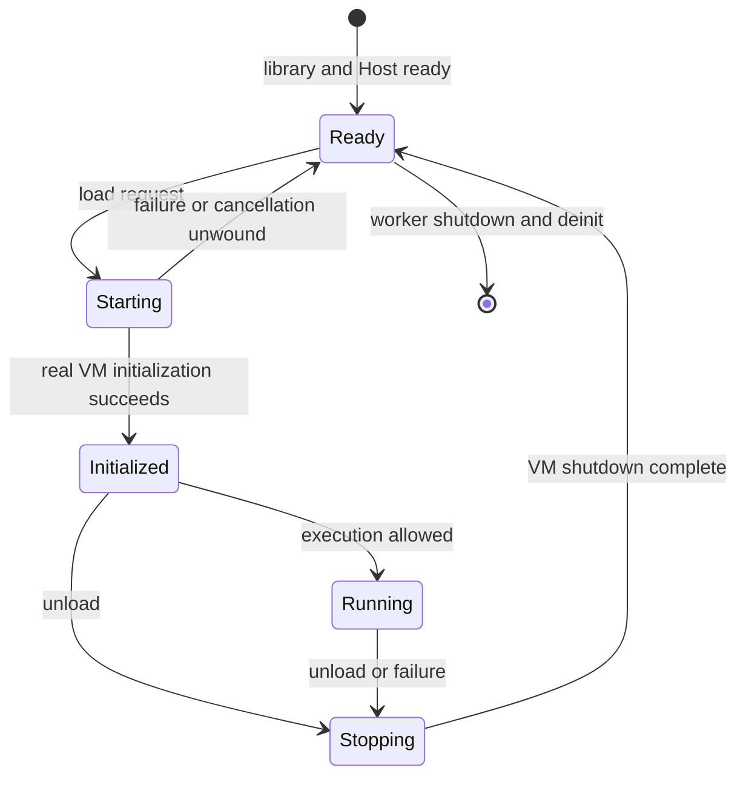

# M1 — Minimal libretro Host

Status: initial design and source mapping prepared; implementation has not started. This document is the M1 work breakdown and review checklist. The [baseline definition](baseline.md) fixes the source revisions, and the [roadmap](roadmap.md) defines the milestone boundary.

## Goal and limits

Build a Windows x86-64 shared library that a libretro frontend can load, connect x6's real Host and VMManager interfaces, forward useful logs, and shut down safely. At least one genuine VM initialization/shutdown cycle is required. ABI exports with simulated VM state changes are only an intermediate step.

M1 does not require a visible game checkpoint, usable game audio, JVS input, or performance improvements. Minimum graphics and device initialization needed by a real VM belongs here. System246 boot parity belongs to M2 and complete basic audio/video/input belongs to M3. This plan authorizes no source import by itself; import and implementation are separate work items.

## What PCEE2 actually provides

The following references use PCEE2 revision `5719627731beb90e379ff1be1223391b7f563b3b`. Its recorded PCSX2 base is newer than the x6 baseline, so these are integration references rather than a patch to apply wholesale.

| Reference | Observed responsibility | Proposed use |
| --- | --- | --- |
| [`pcee2-libretro/CMakeLists.txt`](https://github.com/WizzardSK/pcee2-libretro/blob/5719627731beb90e379ff1be1223391b7f563b3b/pcee2-libretro/CMakeLists.txt) | Shared library linked with `PCSX2` and `PCSX2_FLAGS`, frontend sources, platform link options | Reuse the target shape with project-specific naming; review DLL dependencies and exports |
| [`pcee2-libretro/Libretro.cpp`](https://github.com/WizzardSK/pcee2-libretro/blob/5719627731beb90e379ff1be1223391b7f563b3b/pcee2-libretro/Libretro.cpp) | ABI, settings, CPU worker, session requests, logs, frame handoff, Host implementations | Adapt the minimum lifecycle path; keep later features out of the first import |
| [`pcsx2/GS/GS.h`](https://github.com/WizzardSK/pcee2-libretro/blob/5719627731beb90e379ff1be1223391b7f563b3b/pcsx2/GS/GS.h), [`GSRenderer.cpp`](https://github.com/WizzardSK/pcee2-libretro/blob/5719627731beb90e379ff1be1223391b7f563b3b/pcsx2/GS/Renderers/Common/GSRenderer.cpp) | Framebuffer readback and duplicate-frame callbacks | Later readback reference; these hooks are absent from the x6 baseline |
| [`GSLibretro.h`](https://github.com/WizzardSK/pcee2-libretro/blob/5719627731beb90e379ff1be1223391b7f563b3b/pcsx2/GS/Renderers/Common/GSLibretro.h), Vulkan/OpenGL bridges in the same renderer tree | Frontend-owned presentation and hardware-context sharing | Defer zero-copy and shared-context bridges unless the selected first path requires them |
| [`pcsx2/SPU2/spu2.h`](https://github.com/WizzardSK/pcee2-libretro/blob/5719627731beb90e379ff1be1223391b7f563b3b/pcsx2/SPU2/spu2.h) | `CustomOutputStreamFactory` routes sound to a frontend-owned stream | Defer to M3; x6 already has a Null audio backend for lifecycle checks |
| [`LibretroVFS.cpp`](https://github.com/WizzardSK/pcee2-libretro/blob/5719627731beb90e379ff1be1223391b7f563b3b/pcee2-libretro/LibretroVFS.cpp) and `common/FileSystemVFS.h` | Routes native file access through frontend VFS hooks | Defer full VFS adaptation; M1 uses native desktop file paths |
| [`cmake/EmbedResources.cmake`](https://github.com/WizzardSK/pcee2-libretro/blob/5719627731beb90e379ff1be1223391b7f563b3b/cmake/EmbedResources.cmake) and resource readers | Embeds selected shaders, fonts, and GameDB | Start with matching external x6 resources; embedding is a separate packaging choice |
| [`common/Windows/WinHostSys.cpp`](https://github.com/WizzardSK/pcee2-libretro/blob/5719627731beb90e379ff1be1223391b7f563b3b/common/Windows/WinHostSys.cpp), [`common/CrashHandler.cpp`](https://github.com/WizzardSK/pcee2-libretro/blob/5719627731beb90e379ff1be1223391b7f563b3b/common/CrashHandler.cpp) | Exception-handler lifecycle needed when a module can be unloaded | Review and adapt before claiming safe deinit or DLL unload |

`Libretro.cpp` is not a standalone frontend shim: copying it alone leaves missing hooks and mismatched behavior. Its opening scope comments also describe an earlier version; the pinned code contains audio, input, hardware presentation, and savestate paths beyond that description. Use the implementation, not those comments, to determine dependencies.

## x6 boundary to preserve

Read the fixed x6 [`Host.h`](https://github.com/PS2Homebrew-arcade/pcsx2x6/blob/583f0e90907d69bb2db670f570d0865260fcc71b/pcsx2/Host.h), [`VMManager.h`](https://github.com/PS2Homebrew-arcade/pcsx2x6/blob/583f0e90907d69bb2db670f570d0865260fcc71b/pcsx2/VMManager.h), [`VMManager.cpp`](https://github.com/PS2Homebrew-arcade/pcsx2x6/blob/583f0e90907d69bb2db670f570d0865260fcc71b/pcsx2/VMManager.cpp), and [`pcsx2-qt/QtHost.cpp`](https://github.com/PS2Homebrew-arcade/pcsx2x6/blob/583f0e90907d69bb2db670f570d0865260fcc71b/pcsx2-qt/QtHost.cpp) together.

- Keep `VMBootParameters`, including its x6-specific `arcade` field, and leave `.acgame` interpretation in VMManager.
- Use `VMManager::Internal::CPUThreadInitialize()` for worker-level initialization and `CPUThreadShutdown()` for its matching teardown.
- Use `VMManager::Initialize(params, &error)`, `VMManager::Execute()`, and `VMManager::Shutdown(false)` for each session. Initialization success leaves x6 paused; transition to `Running` only when execution is requested.
- Preserve VMManager's existing partial-initialization guards. Do not call the full shutdown path against an initialization that has already unwound itself.
- Implement frontend-owned Host functions declared across `Host.h`, `VMManager.h`, and `GS/GS.h`; retain the shared Host implementation already provided by the emulator. Keep a symbol inventory to avoid duplicate definitions or hidden Qt dependencies.

## Proposed source and build layout

Retain upstream `pcsx2/`, `common/`, `cmake/`, `bin/`, and `3rdparty/`. Add a separate `libretro/` directory. The following files are proposed boundaries, not files already implemented:

| File or area | Responsibility |
| --- | --- |
| `libretro/CMakeLists.txt` | `pcsx2x6_libretro` shared-library target and platform export rules |
| `libretro/Libretro.cpp` | `retro_*` ABI, callback storage, frontend-thread work |
| `libretro/LibretroHost.cpp` and `.h` | x6 Host adapter, settings, paths, logging |
| `libretro/LibretroSession.cpp` and `.h` | CPU worker, session commands, completion and stop handling |
| `libretro/libretro.h` and `pcsx2x6_libretro.info` | ABI declarations and accurate frontend metadata |
| Focused changes in `common/`, `pcsx2/`, and `cmake/` | Only hooks, cleanup, and build integration required by the selected path |

Add an opt-in `ENABLE_LIBRETRO` switch and keep the standalone build available. The core configuration must not require the Qt application, updater, or gsrunner. x6's `PCSX2` target can be an object library in Multi-ISA builds; retain its existing linkage and all required ISA variants. Do not turn the whole source tree into a shared-library build.

Audit runtime DLL dependencies, MSVC runtime consistency, and exported ABI symbols. PCEE2's static dependency build and platform scripts are references, not mandatory M1 imports. Import the selected sources and their necessary tracked dependencies with license notices and recorded revisions; do not commit BIOS images, game data, compiled dependencies, or build outputs.

## Frontend and Host responsibilities

| Entry point or hook | M1 responsibility |
| --- | --- |
| `retro_set_environment` and callback setters | Store callbacks and obtain logging; handle unsupported optional interfaces |
| `retro_get_system_info`, `retro_get_system_av_info`, `retro_api_version` | Report this core's identity and conservative, valid metadata; advertise only the intended content path |
| `retro_init` | Install logging and initialize the library-level context; retain an error state because this callback cannot return a failure |
| `retro_load_game` | Validate the request, resolve settings/resources, copy owned boot parameters, and submit a real session startup |
| `retro_run` | Service pending frontend work, advance the basic run handshake, and return within a defined wait budget; placeholders do not count as game rendering |
| `retro_unload_game` | Cancel pending boot or stop the active VM, wake every core-owned wait, and wait for session cleanup |
| `retro_deinit` | Also handle an active session; finish worker and process-level cleanup before the module is unloaded |
| `Host::RunOnCPUThread` / `RunOnGSThread` | Dispatch to the owning thread; direct execution is permitted when already on that owner |
| `Host::PumpMessagesOnCPUThread` | Drain commands and implement a cancelable run gate at guest vsync |
| VM notifications, error/progress/UI hooks | Record lifecycle and errors; provide deliberate headless behavior without Qt dialogs or process exit |

All required ABI exports must exist, including functions for unsupported features. Savestates and cheats must report unsupported behavior rather than successful no-ops. Do not inherit PCEE2's broad content extensions, memory exposure, disk-control interface, or no-content support without implementing their contracts. The initial content route can pass a native `.acgame` path unchanged to x6; that is not M2 boot acceptance.

## Settings, resources, and logging

Use a long-lived `MemorySettingsInterface` as the base settings layer, register it once per live Host context, and populate x6 defaults before applying the small set of frontend overrides. Core options are the frontend configuration source; do not silently adopt a user's standalone `PCSX2.ini` or copy PCEE2's optional INI-merging behavior.

Proposed directory contract:

| Frontend location | Core use |
| --- | --- |
| System directory plus `pcsx2x6/` | User-provided BIOS and matching x6 runtime resources |
| Save directory plus `pcsx2x6/` | Writable cards, SRAM, and other persistent arcade state |
| Core-owned writable subdirectories | Logs and caches, with explicit creation/error handling |

The exact x6 SRAM/card path redirection is resolved in M2. M1 must use disposable writable copies if a real initialization opens arcade data. Never fall back silently to the frontend executable's current directory when a required directory is absent. Disable standalone controller discovery, hotkeys, achievement/login prompts, rich presence, and desktop pacing unless required by the chosen diagnostic path. Choose the BIOS explicitly; do not select the first apparently valid retail BIOS for an arcade case.

Use x6's existing `Log::SetHostOutputLevel` callback to map levels into the libretro log interface. A bounded queue drained on the frontend thread keeps worker messages away from callbacks with unclear thread requirements. Keep logging useful when the frontend offers no log interface, avoid format-string forwarding, and disconnect all callbacks before their lifetime ends. Record core/source identity, startup result, and each cleanup stage without publishing user-specific runtime paths in project documentation.

## Worker and session lifecycle

Follow PCEE2's persistent CPU-worker shape, with one initialized worker spanning multiple content sessions until deinit. This matches x6's Qt frontend more closely than recreating global CPU state for each load. A later `retro_init` must be able to create a fresh worker after complete deinit.

These are Host/session concepts, not replacements for x6's `VMState` enum. A deinit request from any active state first cancels or stops the session, then shuts down the worker.

| Owner | Owns or performs |
| --- | --- |
| Frontend callback thread | Libretro callback invocation, request validation, frontend-visible status and bounded waits |
| CPU worker | VM initialization/execution/shutdown, settings application, queued CPU work |
| GS worker | Existing MTGS commands and graphics resources; no direct frontend video callback |
| Session synchronization | Owned boot parameters, startup result, cancellation, completion, run token and frame/progress notification |

Use explicit startup and completion acknowledgements. For a path that needs no frontend hardware-context callback, return `false` from `retro_load_game` on a known startup failure. If a future hardware path must return before VM initialization to let `context_reset` run, document that asynchronous contract and its failure reporting separately. Never wait in `retro_load_game` for a callback the frontend can only invoke after it returns.

Stop/cancel must wake session, command, and frame waits even if no more `retro_run` calls arrive. A cancellation arriving inside synchronous x6 initialization must be remembered and honored at the next safe boundary; document any blocking initializer that still prevents this. Avoid racing `SetState(Stopping)` against initialization and then letting initialization overwrite the stop request. Blocking CPU work must also have cancellation/completion behavior when the session is ending.

Define a wait budget and diagnostic for each frontend-facing wait before implementing it. A timeout is a failed lifecycle check, not permission to detach a live worker or free a DLL containing its code. First make stop requests reach the owner; only then join threads in x6's shutdown order. Start with one simple run-token/vsync handshake and no competing desktop limiter. Queue optimization and duplicate-frame scheduling remain M4 work.

## Minimum graphics and audio decision

The first candidate is x6's existing Vulkan renderer/device in surfaceless mode at native resolution, with a core-owned graphics context and no frontend Vulkan sharing. x6 explicitly maps its Vulkan renderer to that API; a software renderer follows a different API-selection path and is not assumed to select Vulkan. This is a design candidate, not a verified backend. M1 can output a placeholder while establishing real VM lifetime; M2 can add the minimum readback needed for a visible checkpoint.

Neither software GS nor the Null renderer guarantees GPU-free VM initialization: x6 opens a GS device separately. Check `GS/GS.cpp`, `GSDeviceVK.cpp`, `Host::AcquireRenderWindow`, fonts, and shaders before selecting the path. If the existing surfaceless path cannot meet the lifecycle contract, record the exact blocker before importing a different bridge. Do not import PCEE2's Vulkan/OpenGL sharing and paraLLEl-GS paths together.

Use x6's existing Null audio backend during M1 and keep input neutral. The PCEE2 output-stream factory, frame readback hooks, and JVS snapshots become separate work when actually required; their absence must not be hidden behind claims of working audio/video/input.

## Process-level cleanup is part of M1

The x6 baseline's Windows page-fault handler asserts that it has not already been installed, and its public interface has no uninstall function. Its crash-handler interface also lacks the PCEE2 uninstall path. A standalone process can hide these lifetime assumptions; an unloadable core cannot. Audit the matching Windows implementations and adapt only the necessary install/uninstall and restoration behavior before deinit/init and DLL unload are accepted.

`CPUThreadShutdown()` already releases MTGS and VM memory. Check VU-worker closure separately (`vu1Thread.Close()`), outstanding save-state/snapshot workers, settings pointers, log sinks, and any process callbacks retained after deinit. Do this while the library is still callable, not in DLL static destructors or a new process-exit handler. Do not copy PCEE2's `atexit` workaround without proving its necessity and unload safety.

## Implementation checklist

| Step | Work and reviewable artifact | Completion condition |
| --- | --- | --- |
| M1.1 | Import the pinned x6 source with upstream layout, necessary dependencies, notices, and an import manifest; record any selected PCEE2 reuse separately | Import is distinguishable from frontend changes and the standalone build configuration is retained |
| M1.2 | Add the opt-in shared-library target, libretro header/metadata and required exports | Core links and the frontend can load/init/deinit/unload it; dependency and export checks pass |
| M1.3 | Add Host symbol inventory, settings/resource contract, headless responses, and log bridge | Real initialization errors reach the frontend without Qt or an external console window |
| M1.4 | Add worker initialization, session commands, owned parameters, startup acknowledgement and simple run gate | Real VM initialization completes; execution and stop are owned by the CPU worker |
| M1.5 | Resolve minimum GS device/resources and Null audio; keep all required hooks focused | At least one real VM initialize/shutdown cycle completes without relying on simulated state |
| M1.6 | Finish startup failure/cancel, repeated session use, process handlers and worker teardown | Bounded failure/retry, stop during startup, deinit/init, and library unload satisfy the lifecycle contract |

- [x] Map the pinned PCEE2 integration and x6 lifecycle boundary.
- [x] Define the initial build, Host, worker, resource, and cleanup direction.
- [ ] Complete M1.1 — source import.
- [ ] Complete M1.2 — shared-library ABI.
- [ ] Complete M1.3 — Host/settings/logging.
- [ ] Complete M1.4 — real VM sessions.
- [ ] Complete M1.5 — minimum device plumbing.
- [ ] Complete M1.6 — failure and teardown paths.
- [ ] Review the M1 handoff to M2.

## Acceptance procedure

Use one fixed frontend and a known baseline case or a suitable diagnostic boot path. Stop each successful check at the required lifecycle event; no extended gameplay is required.

1. Load/init/deinit/unload the shared library without content.
2. Initialize a real VM, establish the initialized state and any required brief execution, then close content normally. The initialized state is enough for M1; a game image is not a substitute for lifecycle evidence.
3. Cause a controlled missing-resource or invalid-content failure, verify useful errors and cleanup, then retry valid content in the same library context.
4. Request stop while startup is pending; demonstrate that it finishes without another run token, leftover workers, or frontend process exit.
5. Close and reopen content without deinitializing the core; then cycle deinit/init and unload the DLL. Verify that handlers, pointers, and worker lifetimes permit those operations.

Keep execution logs, timings, machine details, and local acceptance outcomes outside this repository. Checkboxes here track implementation artifacts, not a machine-specific pass/fail report. M1 is complete only when the real lifecycle and failure paths meet the roadmap criteria; M1.2 alone does not complete it.

Next: [M2 — Boot One System246 Game](M2.md).
